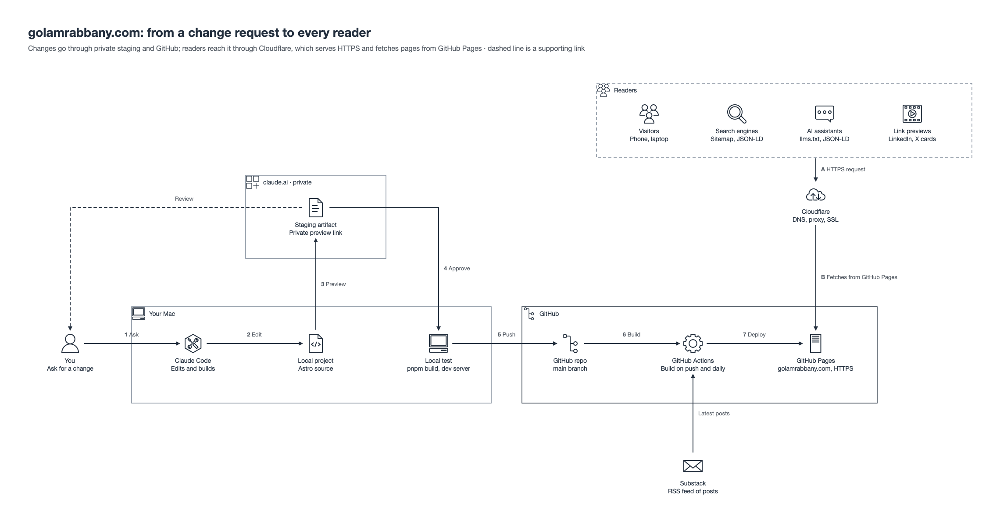

# golamrabbany.com

This is the source for my personal site, [golamrabbany.com](https://golamrabbany.com). I'm a Cloud Security Engineer, and the site is where I keep my work experience, certifications, cloud security projects, CTF results, and the latest posts from my newsletter, [Learn With Rabbany](https://learnwithrabbany.substack.com).

It's a static site built with Astro, React and Tailwind CSS. There's no server or database behind it, which keeps it fast, cheap to run and easy to secure.

## How it fits together



**Publishing.** I make changes locally with Claude Code as my coding assistant, then look at them on a private staging link before anything goes public. Once I'm happy, I test the full build on my Mac and push to `main`. GitHub Actions builds the site, pulls in my latest Substack posts through RSS, and deploys it to GitHub Pages. The same workflow runs every day at 00:00 UTC, so new posts show up without me touching anything.

**Serving.** The domain is on Cloudflare with the proxy turned on. Visitors connect to Cloudflare over HTTPS, and Cloudflare fetches pages from GitHub Pages (SSL mode "Full"), caching them along the way.

**Being found.** Every build generates a sitemap, schema.org structured data about me, and an `llms.txt` summary for AI assistants, so search engines and AI tools get an accurate picture of who I am and what I've done.

## Working on it

You'll need Node 22 or newer and pnpm.

```bash
pnpm install
pnpm dev
```

The site runs at http://localhost:4321.

| Command | What it does |
|---|---|
| `pnpm dev` | Local dev server with live reload |
| `pnpm build` | Production build into `dist/` |
| `pnpm staging` | Build plus a copy in `.staging/` that I publish as a private preview |

## Where things live

- `src/content/`: one markdown file per job, school, certification, project and CTF
- `src/data/resume.tsx`: my profile, section order, skills and social links
- `src/data/config.ts`: site URL, header style, fonts and colors
- `public/`: logos, images and the social preview card
- `.github/workflows/deploy.yml`: build and deploy to GitHub Pages

[EDITING-GUIDE.md](EDITING-GUIDE.md) is my own manual for changing any part of the site.

## License

The code is MIT licensed (see [LICENSE](LICENSE)). The content (my writing, photos and logos) is mine, so please don't reuse it.
